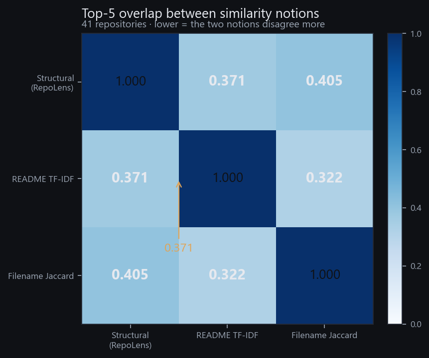
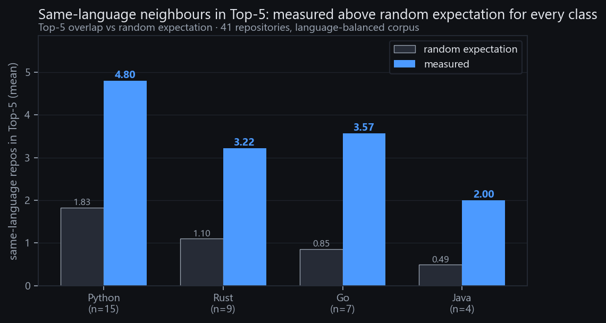
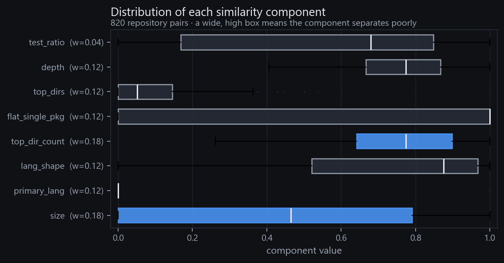
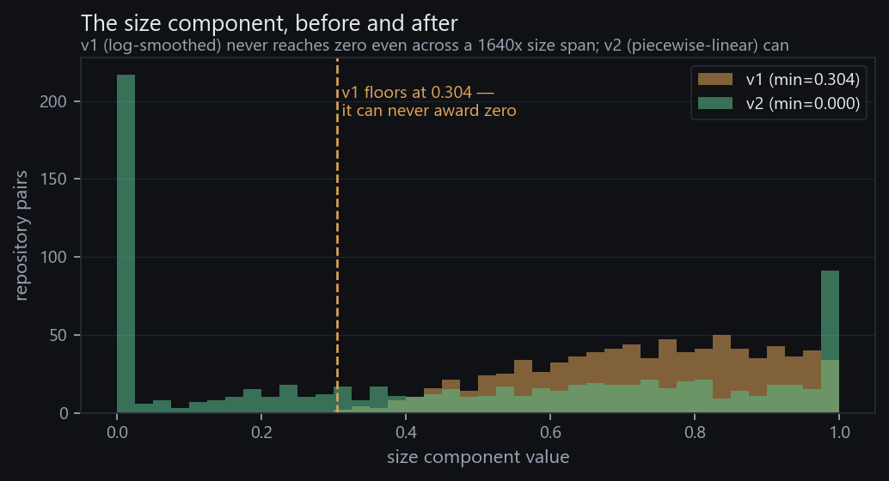

# RepoLens: Interpretable Structural Similarity Retrieval for Source Repositories

### A dependency-free toolkit for finding repositories that are organised like a given one, with a per-result explanation

---

## Abstract

Repository similarity is usually computed from content: README text, issue text, commit
messages, or learned embeddings over source files. Such signals describe what a project is
*about*. A different and practically useful question is how a project is *organised*: where
the package lives, how tests are laid out, whether the tree is one flat module or a dozen
sub-packages. We present RepoLens, a tool that retrieves repositories by structural
similarity. RepoLens extracts five filesystem-derived features without parsing source code
and combines eight closed-form, individually interpretable components into a single weighted
score. Every retrieved neighbour is accompanied by a per-component breakdown and a
natural-language explanation of why it was matched. The distributed artifact is one
self-contained 227 KB HTML file that opens offline with no server and no network access.

On a 41-repository corpus balanced across four language classes, the Top-5 lists produced by
RepoLens overlap those produced by README TF-IDF similarity by 0.371 and those produced by
filename Jaccard by 0.405. For roughly three of every five retrieved slots, the two notions
of similarity name different repositories. We also report measurements that constrain the
method: the first formulation of the size component never reached zero and bottomed out at
0.304, language similarity is an emergent property of the weighted combination rather than a
designed guarantee, and the weights are not supervised because no labelled dataset exists for
architectural similarity.



---

## 1. Introduction

When an automated coding agent is placed into an unfamiliar repository, what most strongly
conditions its success is not the topic of the project but its engineering conventions: where
the package lives, how tests are laid out, whether the tree is one flat module or a dozen
sub-modules. An agent that has seen many projects organised like the current one can
anticipate where to look and where to write.

Tools that answer "find a similar repository" overwhelmingly answer with content signals:
README text, issue titles, commit messages, or embeddings over source. These measure what a
project is about. They do not directly measure how a project is organised, and we were unable
to find a widely used tool that retrieves repositories by organisational structure while
showing its reasoning per result.

RepoLens addresses that gap. It contributes a structural similarity function of eight
closed-form components over five filesystem-derived features, each carrying a
natural-language explanation rendered next to the result; a measurement of how far
structural and content similarity diverge on a shared 41-repository corpus; a single
self-contained HTML dashboard that runs with no server, no network call and no build step;
and negative results with measurements attached, stated plainly in Section 7. We claim no
state-of-the-art retrieval accuracy. RepoLens is a deterministic, auditable lens for a
question that content retrieval answers poorly, and Section 5 quantifies how differently the
two lenses behave.

## 2. Related Work

**Agentic software engineering evaluation.** SWE-bench [1] established the protocol this
competition follows: generate a patch, run the repository's own tests, and record pass or
fail. Its 2,294 task instances come from real GitHub issues across 12 Python repositories.
RepoLens does not compete on that leaderboard; it characterises the repositories in which
such tasks live, and our corpus overlaps the Python ecosystem SWE-bench draws on.

**Repository-level similarity.** Repo2Vec [4] is the closest prior work. It represents a
repository as a distributed vector combining metadata, repository structure, and source
code, and evaluates retrieval against 1,013 GitHub repositories, establishing both that
repository similarity is a meaningful retrieval task and that structural information is
useful within it. Our work differs along three axes. Repo2Vec is a learned embedding whose
similarity is not decomposable by inspection, whereas RepoLens is a closed-form function
whose eight terms can each be read, recomputed, and argued with. Repo2Vec requires a training
and dependency stack, whereas the RepoLens core runs on the Python standard library alone.
Repo2Vec reports precision against a partially supervised notion of "strongly similar",
whereas RepoLens makes no accuracy claim and instead reports how its ranking diverges from a
content baseline. Rao and Chimalakonda [5] show that similar software projects can be
identified through dissimilar artifacts, the general phenomenon our 0.371 overlap measures
on a larger corpus.

**Code and content similarity.** A systematic literature review of source code similarity
measurement and clone detection [2] surveys 136 primary studies and 80 tools, and frames
similarity as serving code recommendation, duplicate detection, plagiarism, malware and
smell detection. That literature concerns pairwise judgement over code identity. Retrieval
over whole repositories, where the unit is a project and the question is architectural
comparability, appears far less directly. CodeBERT [3] learns joint natural-language and
programming-language representations and is widely used for code search; RepoCoder [6]
retrieves repository context to improve repository-level code completion. Both are content
representations, and RepoLens complements them rather than replacing them.

We did not find a prior system that performs structural repository retrieval with a
per-result explanation, and the work above is the closest we verified. Tree-comparison
approaches to fork detection and AST-based clone detection are therefore described
generically rather than attributed to papers we did not read in full. This is a scope limit,
stated rather than hidden.

## 3. The RepoLens Method

### 3.1 Features

Five features are extracted from the filesystem. No source file is parsed and no language
grammar is required, so the extractor works on any repository.

| Feature | Definition | Role |
|---|---|---|
| Code file count | source files, excluding tests, docs and config | scale |
| Primary language | most frequent language by file count | technology stack |
| Language entropy | normalised entropy of the language distribution | single-language vs polyglot |
| Top-level layout | set of top-level directory names | engineering organisation |
| Source:test ratio | `(code files − test files) / test files` | testing culture |

Excluded directories include `.git`, `.github`, `node_modules`, `__pycache__`, `.venv`,
`dist`, `build`, `.mypy_cache`, `.pytest_cache`, `.tox` and `.next`.

### 3.2 The eight components

Each component is a closed-form function with an explicit definition, and each carries a
natural-language phrase rendered with the result.

| Component | Weight | What it measures |
|---|---|---|
| `size` | 0.18 | ratio-segmented closeness of code-file counts |
| `primary_lang` | 0.12 | equality of the dominant language |
| `lang_shape` | 0.12 | difference in language entropy |
| `top_dir_count` | 0.18 | log closeness of the top-level directory count |
| `flat_single_pkg` | 0.12 | whether the layout is a single flat package |
| `top_dirs` | 0.12 | Jaccard over top-level directory names |
| `depth` | 0.12 | log closeness of maximum tree depth |
| `test_ratio` | 0.04 | log closeness of the source-to-test ratio |

The weights sum to 1.00. `size` uses piecewise-linear decay on the log ratio: full credit
within 1.3×, zero beyond 20×, interpolated logarithmically between. Two components exist
because diagnostics demanded them. `flat_single_pkg` was added after `top_dirs` was found to
score below 0.3 on 71% of the 171 pairwise combinations in an earlier 19-repository corpus:
top-level directory names rarely overlap, and pure Jaccard discards the fact that
`fastapi/fastapi` and `flask/src/flask` are both single-package layouts. `top_dir_count` and
`depth` were added so hierarchical granularity is represented independently of names.
`primary_lang` carries 0.12 rather than a larger weight because, as Section 5.3 shows, it
alone does not make the ranking language-aware; its weight is a design trade-off, not a tuned
optimum.

### 3.3 Output

Each retrieved neighbour is rendered with its score, an eight-bar component breakdown, and a
sentence explaining the match. For the query `tiangolo/fastapi` and the neighbour
`sanic-org/sanic` (score 0.5559) the rendered explanation is: `[medium similarity] different
primary language; code sizes differ by about 9x (3277 vs 350); both are flat single-package
layouts; directory depth is close (14 vs 6 levels)`. The dashboard lists all corpus
repositories with search and displays the Top-12 neighbours for the selected target.

## 4. Corpus and Experimental Setup

### 4.1 Corpus

The corpus contains 41 GitHub repositories cloned at depth 1, balanced across four language
classes: Python 15, Rust 9, Go 7 and Java 4. The remaining repositories are C# 2, TypeScript
2, JavaScript 1 and one `ReST`-classified repository. Feature extraction is cached per
repository, so an interrupted run resumes without recomputation, and corpus membership is
pinned by an `owner/repo` list. All 41 repositories yielded a README of at least 200
characters, so none was excluded from the content baseline.

### 4.2 Baselines

We compare three notions of similarity over the identical corpus:

| Code | Method |
|---|---|
| M | RepoLens structural similarity (the weights of Section 3.2) |
| B1 | README text, TF-IDF cosine (`sublinear_tf`, `min_df=2`, 20,000 features) |
| B2 | filename-token Jaccard (ASCII stems of at least 4 characters, high-frequency tokens removed) |

For each query repository we take the Top-5 from each method and measure the fraction of
shared members. This tests whether the notions agree, and it requires no labelled ground
truth, which we do not have.

### 4.3 Reproducibility

The core scorer uses only the Python standard library; scikit-learn is needed only for the
README TF-IDF baseline and figure generation. Fifteen self-test and verification scripts
exit zero. Every number in this paper is recomputed from stored artifacts by
`src/derive_truth.py`, and the verification scripts compare the documents against that file
rather than against hardcoded expectations, because stale constants had already drifted into
figures and text three times during development.

## 5. Results

### 5.1 Structural and content similarity are near-orthogonal

| Comparison | Mean Top-5 overlap |
|---|---|
| structural ∩ README TF-IDF | **0.371** |
| structural ∩ filename Jaccard | 0.405 |
| README TF-IDF ∩ filename Jaccard | 0.322 |

The two content baselines agree with each other slightly *less* than structure agrees with
either, which places the structural signal in the same range of disagreement as two
independent content methods. An overlap of 0.371 means about three of every five retrieved
slots differ depending on which notion is used, so a practical system would expose both.

### 5.2 Divergence cases

**Structure retrieves what content misses.** For `Textualize/textual`, the highest-ranked
structural neighbour absent from the content Top-5 is `tox-dev/tox`, at structural score
0.7724 against a README TF-IDF score of 0.1337. The projects share no vocabulary and no
author, but both are single-package Python projects with a comparable hierarchy.

**Content retrieves what structure misses.** For the same query, README similarity ranks
`Textualize/rich` first at 0.3308, and the structural score for that pair is 0.6634. `rich`
does not appear in the structural Top-5. The two repositories come from the same team and
share jargon, which README text captures and directory layout does not. A structural lens
cannot substitute for content retrieval where authorship or domain language is shared.

### 5.3 Language behaviour

We asked how often a repository's Top-5 neighbours share its primary language, and compared
that against the random expectation implied by corpus composition.

| Language | Repositories | Random expectation | Measured |
|---|---|---|---|
| Python | 15 | 1.83 | 4.80 |
| Rust | 9 | 1.10 | 3.22 |
| Go | 7 | 0.85 | 3.57 |
| Java | 4 | 0.49 | 2.00 |

Every language class exceeds its random expectation, by a factor between 2.6 and 4.2. The
effect is real on this corpus, and it is *emergent*: `primary_lang` is one weighted component
of eight, and the remaining seven assign partial credit across language boundaries. We
therefore report this as a property of the weighted combination rather than a designed
guarantee, and we do not claim it transfers to corpora with different class balances. Under
the earlier weight configuration the same measurement was Python 5.00, Rust 3.78, Go 4.57
and Java 2.25, so the qualitative conclusion is stable across the two settings while the
magnitudes are not.



## 6. Component Analysis

### 6.1 Component distributions

Aggregating over all 820 repository pairs gives a per-component view that headline scores
hide.

| Component | Weight | Min | Median | Max | Fraction below 0.3 |
|---|---|---|---|---|---|
| `size` | 0.18 | 0.000 | 0.465 | 1.000 | 0.395 |
| `primary_lang` | 0.12 | 0.000 | 0.000 | 1.000 | 0.793 |
| `lang_shape` | 0.12 | 0.000 | 0.876 | 1.000 | 0.080 |
| `top_dir_count` | 0.18 | 0.261 | 0.774 | 1.000 | 0.004 |
| `flat_single_pkg` | 0.12 | 0.000 | 1.000 | 1.000 | 0.461 |
| `top_dirs` | 0.12 | 0.000 | 0.053 | 1.000 | 0.915 |
| `depth` | 0.12 | 0.406 | 0.774 | 1.000 | 0.000 |
| `test_ratio` | 0.04 | 0.000 | 0.680 | 1.000 | 0.300 |

Three observations follow. `top_dirs` is sparse by construction: 91.5% of pairs score below
0.3, because real repositories rarely share top-level directory names. It is a strong signal
in the minority of pairs where names do coincide, not a smooth general feature.
`primary_lang` is binary and its median is 0.000, because most pairs here are cross-language.
`top_dir_count` and `depth` have high minima, 0.261 and 0.406, so they rarely award a very
low score. They carry the same defect as the first version of `size` in milder form, and we
have not fixed them.



### 6.2 The size component, before and after

The first formulation of `size` used log smoothing with an epsilon offset. Its minimum over
all 820 pairs is 0.304 (median 0.744). The corpus spans 24 to 39,364 code files, a ratio of
1,640×, so the most extreme size difference still earned roughly a third of the size credit:
numerically stable and semantically wrong.

The replacement is piecewise-linear on the log ratio: full credit within 1.3×, zero beyond
20×. Its minimum on the same 820 pairs is 0.000 and its median is 0.465. The distribution
shifts, not merely the floor.



### 6.3 Weight sensitivity

The weights come from unsupervised diagnostics and explicit trade-offs; no labelled set of
architecturally similar pairs exists, so they are not supervised. The language measurements
in Section 5.3 shift in magnitude between the two weight configurations we tried while
keeping their sign, which suggests the qualitative conclusion is not an artifact of one
setting. The overlap figures in Section 5.1 are computed under the shipped weights and would
move under a different weighting. We report the weights as a documented design choice, not an
optimum.

## 7. Limitations and Failure Modes

**No supervision.** There is no labelled dataset of architecturally similar repository pairs,
so the weights cannot be validated against ground truth. All results here are unsupervised
and descriptive, and a supervised weight-fitting path is the main missing piece.

**Language is not discriminated reliably.** Section 5.3 reports an aggregate effect above
chance, not per-query reliability. An earlier run on a 19-repository corpus, of which 16 were
Python and 2 Go, produced the opposite reading: a Go query's best Python candidate scored
0.5501 against its best Go candidate at 0.5644. Class imbalance is a real confound, and users
should not expect the language component to enforce language-consistent results.

**Two components are sparse or rarely low.** `top_dirs` scores below 0.3 on 91.5% of pairs,
so weighting it at 0.12 dilutes the signal for most pairs. `top_dir_count` and `depth` have
minima of 0.261 and 0.406, inheriting the same logarithmic closeness function that produced
the original `size` floor. That remains unfixed.

**Corpus scale.** 41 repositories is enough to state the divergence between structural and
content similarity, and not enough to support claims about retrieval quality in general. The
corpus holds only open-source projects with conventional layouts; vendored, monorepo and
generated-code-heavy trees are under-represented.

**Layout features are coarse.** The method reads the shape of the tree, not the semantics of
what lives in it. Two repositories can share a directory profile while sharing nothing else,
and the explanation will report that they are structurally alike, because at the level this
tool measures, they are.

**No confidence intervals.** We report means over 41 queries and have not run significance
tests, so differences between values such as 0.371 and 0.405 should not be read as ranked.

## 8. Availability

RepoLens is released under the MIT licence. The corpus repositories retain their own
licences; RepoLens stores derived statistics and does not redistribute third-party source.

```
src/                           core scorer, dashboard, verifiers (stdlib core)
runs/balanced/dashboard.html   offline dashboard (227 KB, 41 repos, Top-12)
runs/figures/                  the four figures in this paper
derive_truth.py                recomputes every number in this paper
```

To reproduce from a clone:

```bash
python corpus.py --list ../repos.txt --dest ../corpus   # resumable, disk-capped
python run_similarity.py --corpus ../corpus --out ../runs/demo
python dashboard.py ../runs/balanced                    # writes dashboard.html
python derive_truth.py                                  # recompute all paper numbers
```

The dashboard opens by double-clicking the HTML file and makes no network request.

## 9. Conclusion

RepoLens makes the organisational structure of a repository retrievable and inspectable. On a
41-repository balanced corpus its rankings disagree with README TF-IDF similarity on roughly
three of every five retrieved slots, in both directions, and its failure modes are measured
rather than asserted.

## References

[1] C. E. Jimenez et al., "SWE-bench: Can Language Models Resolve Real-World GitHub
Issues?", ICLR 2024. arXiv:2310.06770

[2] M. Zakeri-Nasrabadi et al., "A systematic literature review on source code similarity
measurement and clone detection: techniques, applications, and challenges", 2023.
arXiv:2306.16171

[3] Z. Feng et al., "CodeBERT: A Pre-Trained Model for Programming and Natural Languages",
Findings of EMNLP 2020. arXiv:2002.08155

[4] M. O. F. Rokon, P. Yan, R. Islam, M. Faloutsos, "Repo2Vec: A Comprehensive Embedding
Approach for Determining Repository Similarity", ICSME 2021. arXiv:2107.05112

[5] A. E. Rao, S. Chimalakonda, "Apples, Oranges & Fruits: Understanding Similarity of
Software Projects Through The Lens of Dissimilar Artifacts", 2021. arXiv:2103.01475

[6] F. Zhang et al., "RepoCoder: Repository-Level Code Completion Through Iterative
Retrieval and Generation", EMNLP 2023. arXiv:2303.12570
